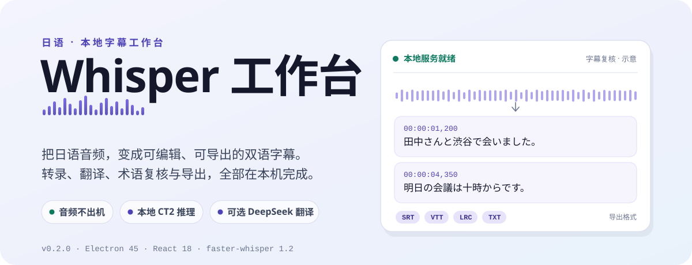
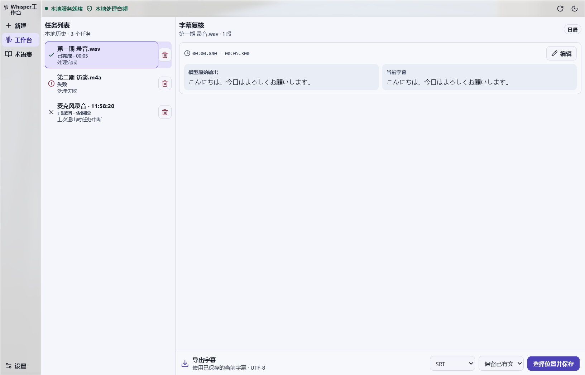
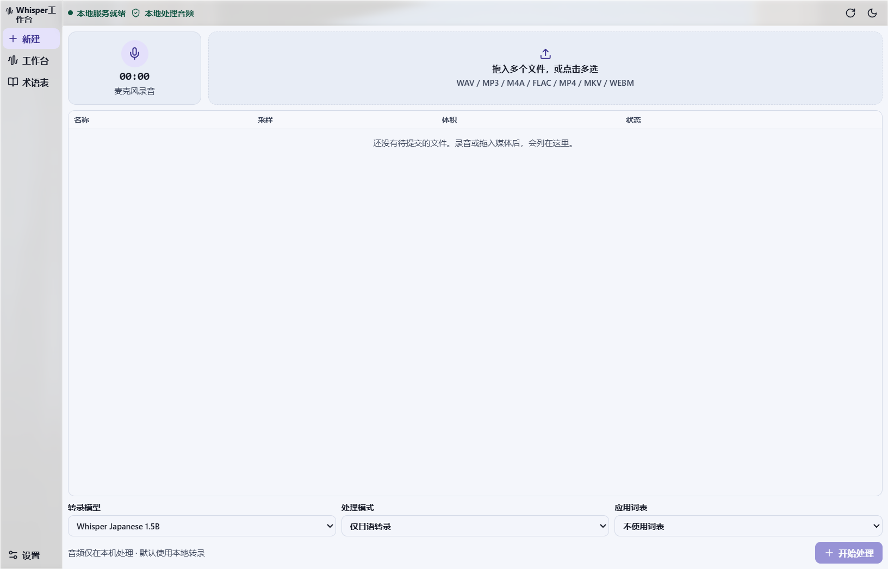
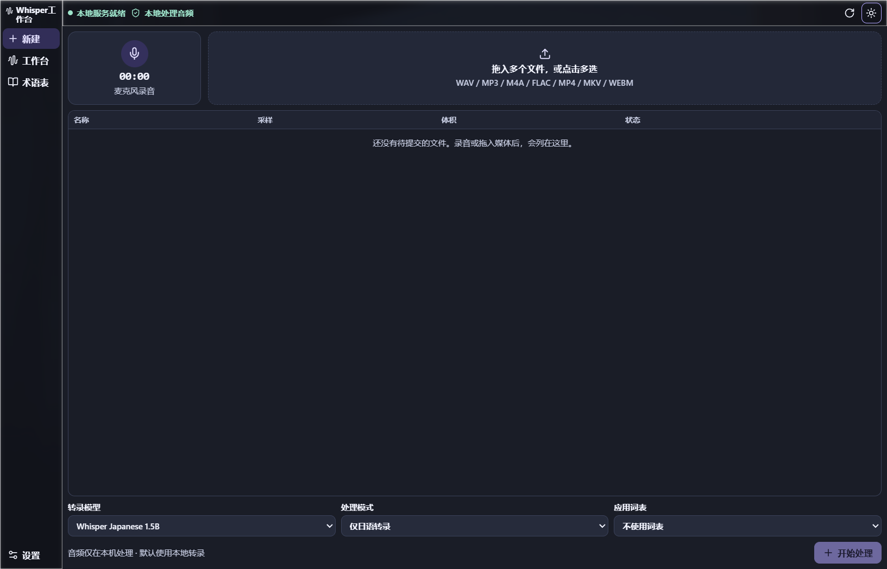
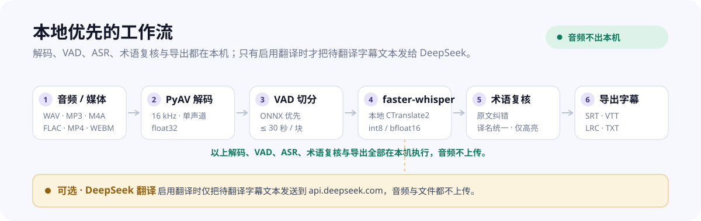

<div align="center">
  
</div>

<p align="center">
  <a href="https://github.com/HanaAyane/whisper-workbench/releases/tag/v0.2.0"></a>
  
  
  
</p>

<p align="center">
  本地优先的日语字幕工作台：录音或导入媒体，用 faster-whisper 在本机转录，按需日中翻译、术语复核，最后导出 SRT / VTT / LRC / TXT。<br/>
  音频始终留在本机，只有在启用翻译时才把待翻译的字幕文本发给 DeepSeek。
</p>

<p align="center">
  <a href="#界面预览">界面预览</a> ·
  <a href="#为什么本地优先">为什么本地优先</a> ·
  <a href="#快速开始">快速开始</a> ·
  <a href="#主要能力">主要能力</a> ·
  <a href="#技术参考">技术参考</a>
</p>

---

## 界面预览

<p align="center">
  
</p>
<p align="center"><sub>字幕复核：左边是模型原始输出，右边是当前字幕。术语建议可逐条接受或拒绝，底部按 SRT / VTT / LRC / TXT 导出。</sub></p>

<p align="center">
  
  
</p>
<p align="center"><sub>新建与批量导入（左，浅色）· 深色主题（右）。支持录音、拖入或多选 WAV / MP3 / M4A / FLAC / MP4 / MKV / WEBM。</sub></p>

## 它是什么

Whisper工作台是一个跑在 Electron 窗口里的**日语字幕工具**。它面向在自己电脑上做日语字幕的人：把录音或媒体文件交给本地的 faster-whisper 转录，在同一个窗口里改文稿、核对术语、按需翻译，最后导出字幕。任务、字幕、词表和配置都留在本机。

- **一屏走完**：新建 → 队列 → 字幕复核 → 导出，不需要在多个工具之间来回倒文件。
- **本地推理**：音频解码、VAD 与 ASR 全部在本机完成，模型权重由用户提供。
- **可选外发**：只有主动选择翻译时，才把待翻译的字幕文本发给 DeepSeek；音频和文件都不上传。

## 为什么本地优先

转写工具最敏感的是录音本身。工作台把「处理音频」和「联网」拆开：解码、VAD、ASR、术语匹配与导出都在本机，网络只用于一种可选的、用户主动开启的服务——DeepSeek 翻译，而且只发送字幕文本。

<p align="center">
  
</p>

- **默认离线**：`mode=transcribe` 不联网、不需要 Key。
- **唯一外网请求**：启用翻译时，请求只发往 `https://api.deepseek.com`，内容是带边界包裹的字幕文本，不含音频。
- **提示词加固**：后端始终追加固定规则，并把字幕文本用 `<subtitles>` 标签包裹、转义标记字符，字幕里出现指令也不会被当作命令执行。

## 主要能力

- **本地日语转录**：faster-whisper + CTranslate2，支持 CUDA / CPU，默认 `int8`；模型按安装目录 `model/` 自动发现。
- **批量导入与自动导出**：一次多选或拖入多个混合格式媒体，逐项校验、按列表顺序入队；每条成功后自动把字幕写入输出目录，同名自动加序号并保护已有文件。
- **可选日中翻译**：DeepSeek Chat Completions，只发字幕文本；设置页可填 Key、拉取模型列表、选择思考强度、编辑系统提示词。
- **术语表与匹配**：`exact` 精确匹配、别名与变体、最长匹配优先、`priority` 加权，`correct`（原文纠错）/ `translate`（译名统一）/ `keep`（仅高亮）三种策略；CSV / JSON 导入导出。
- **字幕复核**：模型原始输出与当前字幕并排；逐条接受或拒绝术语建议、撤销最近一次替换、手工编辑并保存，`revision` 校验防止旧草稿覆盖。
- **多格式导出**：SRT / VTT / LRC / TXT，默认保护同名文件；覆盖时先写临时文件再替换。
- **任务队列与历史**：SQLite 持久化，WebSocket 实时推送阶段与进度，排队可取消；工作台可删除已结束的历史任务。

## 快速开始

需要 Windows x64 或 Apple Silicon（arm64）的 macOS。发布包不含模型权重，需要自己放好本地模型。

### 1. 准备模型

日语转录需要两个本地模型，放入**安装目录**的 `model/` 下（macOS 放置方式相同）：

- **日语转录模型（必需）**：[Jim6789/whisper-ja-1.5B-ct2](https://huggingface.co/Jim6789/whisper-ja-1.5B-ct2)（约 6.18 GB，`efwkjn/whisper-ja-1.5B` 的 CTranslate2 转换版）。把整个仓库的 `model.bin`、`config.json`、`tokenizer.json`、`preprocessor_config.json`、`vocabulary.json` 放到 `model/whisper-ja-1.5B/`（子目录名即模型 id，可自定义）。
- **VAD 语音活动检测模型（必需）**：[TransWithAI/Whisper-Vad-EncDec-ASMR-onnx](https://huggingface.co/TransWithAI/Whisper-Vad-EncDec-ASMR-onnx)。下载 `model.onnx`（约 113.6 MB）与 `model_metadata.json`，重命名为 `whisper_vad.onnx` 与 `whisper_vad_metadata.json`，放在 `model/` 根目录。

下载方式任选：浏览器逐个下载；`pip install huggingface_hub` 后执行 `huggingface-cli download Jim6789/whisper-ja-1.5B-ct2 --local-dir whisper-ja-1.5B`；或用 `git clone`（需 Git LFS，否则 `model.bin` 只是指针文件）。访问缓慢时把域名 `huggingface.co` 换成镜像 `hf-mirror.com`。放好后在「设置」页点「重新扫描」，模型显示「可用」即可选用。

### 2. 安装

- **Windows x64**：运行 `Whisper工作台-0.2.0-win-x64-setup.exe`，安装到所选目录（支持含空格或中文的路径），包内已含 Python sidecar。本地数据位于 `%APPDATA%\jp-voice-workbench`。
- **macOS arm64**：打开 `Whisper工作台-0.2.0-mac-arm64.dmg`，把「Whisper工作台」拖入「应用程序」（ZIP 解压得到同样的 `.app`）。本地数据位于 `~/Library/Application Support/jp-voice-workbench`。

Windows 为本地未签名构建，macOS 为 ad-hoc 签名、未公证。macOS 首次打开会被 Gatekeeper 拦截，右键应用选择「打开」，或到「系统设置 → 隐私与安全性」允许一次；不要用 `xattr` 或关闭 Gatekeeper 绕过。

CPU 使用默认的 `int8`；NVIDIA GPU 需相容驱动和 CUDA 运行环境。从 `v0.1.0` 升级的用户，按[从 0.1.0 迁移模型](docs/migration-model-dir.md)把原模型文件复制到新的 `model/` 目录；卸载会删除整个安装目录（含 `model/`），需保留模型时请先复制到安装目录之外。

### 3. 第一次运行

1. 打开「设置」页，确认模型目录、发现的本地 Whisper CT2 模型与逐文件校验结果；放好模型后点「重新扫描」。空目录或缺文件时，设置页会显示准确的放置路径、示例子目录、缺少的文件名与获取说明。
2. 在「新建」录制约 10 秒日语，或拖入媒体，点「开始处理」；在「工作台」查看进度，完成后进入「字幕复核」。
3. 选择字幕格式与覆盖策略，导出并保存。

> 只有需要日中翻译时，才在用户数据目录的 `.env` 或环境变量配置 `DEEPSEEK_API_KEY`，或在「设置 → DeepSeek 服务」里直接填写 Key。详见下文[技术参考](#技术参考)。

## 使用指南

- **批量处理**：在「新建」一次性多选或拖入多个音频/视频（可混合格式），列表显示名称、采样、体积和逐项校验结果。先选择模型、字幕格式和输出目录，点「开始批量处理」后按列表顺序逐条入队；每条成功转录后自动把字幕写入输出目录。
- **字幕复核**：并排查看模型输出和当前字幕；可手改保存、逐条接受或拒绝术语建议，也可撤销最近一次仍可撤销的替换。纯静音或合成正弦波可能生成空 SRT。
- **删除历史**：工作台可删除已结束的历史任务，会移除任务记录和已保存字幕；排队或处理中的任务需先取消。删除不影响导入的媒体文件和用户保留的录音副本。
- **术语表**：导入 `examples/glossary.demo.json`，用 `田中さんと渋谷で会いました` 验证高亮和替换预览；也可直接维护词条或导出 CSV / JSON。
- **设置**：选择含 `manifest.json` 的目录、推理设备、计算类型和默认导出目录；模型目录、任务与已保存字幕在重启后恢复。
- **录音临时文件**：任务完成、失败、取消或正常退出时清理；异常退出留下的临时录音会在下次启动时清理。勾选「保留录音副本」会在用户数据目录的 `recordings/` 保留 WebM。

### 一个例子：模型输出 → 术语纠错后导出

模型原始输出：

```srt
1
00:00:01,200 --> 00:00:04,350
田中さんと渋谷で会いました。
```

应用术语表（`田中 → 田中太郎` 原文纠错、`渋谷 → 涩谷` 译名统一）并补上中文译文后导出：

```srt
1
00:00:01,200 --> 00:00:04,350
田中太郎さんと渋谷で会いました。
我和田中先生在涩谷见了面。
```

> 以上为合成示例，用于演示术语复核如何作用于「模型原始输出」与「当前字幕」两份内容；原始输出始终保留。

## 开发、测试与打包

需要 Node.js 24、pnpm 11.21.0、Python 3.10 的项目 `.venv`。项目使用 `.venv`（本机实际用 uv 创建）：

```powershell
uv python install 3.10
uv venv --python 3.10 .venv
uv pip sync --python .venv/Scripts/python.exe backend/requirements.txt
uv pip check --python .venv/Scripts/python.exe
```

[requirements.in](backend/requirements.in) 声明直接依赖与用途，[requirements.txt](backend/requirements.txt) 锁定全部传递依赖及哈希。修改依赖后重新生成：

```powershell
uv pip compile backend/requirements.in --python .venv/Scripts/python.exe --generate-hashes --output-file backend/requirements.txt
```

启动桌面工作台（开发版，从项目目录读取模型，需要 `models/manifest.json`）：

```powershell
pnpm --dir apps/desktop install --frozen-lockfile
pnpm --dir apps/desktop dev
```

打包（Windows 在仓库根目录执行；macOS 用 `.venv/bin/python` 并执行同一套命令）：

```powershell
uv pip install --require-hashes --python .venv/Scripts/python.exe -r backend/requirements.txt -r backend/requirements-build.txt
pnpm --dir apps/desktop install --frozen-lockfile
pnpm --dir apps/desktop build
pnpm --dir apps/desktop dist
```

PyInstaller 将 sidecar 输出到 `backend/dist/sidecar/`，Electron Builder 将其复制到应用资源目录。产物位于 `apps/desktop/release/`：Windows 只生成 NSIS 安装版 `Whisper工作台-0.2.0-win-x64-setup.exe`（安装时按 `apps/desktop/scripts/installer.nsh` 在安装目录创建 `model/` 并写入放置说明）；macOS 生成 `Whisper工作台-0.2.0-mac-arm64.dmg`、同名 ZIP 及 blockmap，`scripts/after-pack.cjs` 在打包后做 ad-hoc 签名，配置 Developer ID 证书后 Electron Builder 会用真实证书覆盖该签名（当前未做公证）。

从 GitHub 下载 Electron 或 Electron Builder 二进制过慢时，可加镜像环境变量后重跑：

```bash
export ELECTRON_MIRROR=https://npmmirror.com/mirrors/electron/
export ELECTRON_BUILDER_BINARIES_MIRROR=https://npmmirror.com/mirrors/electron-builder-binaries/
pnpm --dir apps/desktop dist
```

开发检查（激活 `.venv` 后）：

```powershell
python scripts/check_repository.py
python -m ruff check backend scripts
python -m ruff format --check backend scripts
python -m pytest -q
pnpm --dir apps/desktop lint
pnpm --dir apps/desktop typecheck
pnpm --dir apps/desktop test
pnpm --dir apps/desktop build
```

若本机旧的系统 pytest 临时目录权限异常，可指定项目内临时目录，不修改系统权限：

```powershell
New-Item -ItemType Directory -Force data/tmp | Out-Null
$env:TMPDIR = (Resolve-Path data/tmp).Path
python -m pytest -q
```

CI 在 Windows 和 Linux 运行 Python 3.10 与 Node 24 检查，测试使用合成数据或 mock。

## 技术参考

<details>
<summary><b>环境与依赖</b></summary>

使用 Node.js 24、pnpm 11.21.0、Electron 45.2.3 和 Python 3.10。后端安装 FastAPI、Pydantic、Uvicorn、PyAV、NumPy、ONNX Runtime、faster-whisper 1.2.1、CTranslate2 4.8.5、pyahocorasick 2.3.1 和检查工具。真实 ASR 加载与推理已在 RTX 4070（CUDA，bfloat16）上验证。翻译使用 DeepSeek API。

也可用 pip 创建 `.venv`（PowerShell）：

```powershell
py -3.10 -m venv .venv
.\.venv\Scripts\python.exe -m pip install --require-hashes -r backend/requirements.txt
.\.venv\Scripts\Activate.ps1
```

</details>

<details>
<summary><b>模型准备（开发版清单）</b></summary>

开发版从项目目录读取模型，需要手写清单；**安装版无需清单**，直接把模型放入 `<安装目录>/model/<模型子目录>/` 由应用自动扫描。将 [manifest.example.json](examples/manifest.example.json) 复制到本地 `models/manifest.json` 并修改路径（相对路径以项目根解析，也支持外部绝对路径）：

```powershell
New-Item -ItemType Directory -Force models | Out-Null
Copy-Item examples/manifest.example.json models/manifest.json
python scripts/verify_models.py
```

每个 CT2 模型检查 `model.bin`、`config.json`、`tokenizer.json`、`preprocessor_config.json`、`vocabulary.json`；VAD 检查 ONNX 和 metadata 文件。脚本退出码 0 表示文件齐全，1 表示缺失/清单错误并逐项打印路径。不要猜测不明模型的身份，不自动下载模型。

</details>

<details>
<summary><b>单独启动 Sidecar（HTTP / WebSocket 接口）</b></summary>

激活 `.venv` 后，在 `backend` 目录执行：

```powershell
uvicorn app.main:app --host 127.0.0.1 --port 8765
```

默认每次启动生成随机 token，通过本地 stdout 的 `SIDECAR_TOKEN {"token":"..."}` 行交付；请求使用 `X-Sidecar-Token` header。不要把该行重定向到共享日志。服务提供 `/api/health`、`/api/models`、`POST /api/jobs` 与 `GET /api/jobs/{id}`；健康/模型接口不会加载模型或联网。内置入口 `python -m app.main` 固定监听 `127.0.0.1:8765`。

为运行固定 `dev` 的验收示例，必须显式设置开发 token，不存在默认后门：

```powershell
$env:SIDECAR_TOKEN = 'dev'
uvicorn app.main:app --host 127.0.0.1 --port 8765
curl.exe -H "X-Sidecar-Token: dev" http://127.0.0.1:8765/api/health
```

健康接口返回 `{status, version, models_ok}`；缺模型时保持 `status=ok`、`models_ok=false`。缺失/错误 token 返回 401，非法 Origin 返回 403；CORS 只允许 `http://127.0.0.1` 及其端口。

任务与字幕相关接口：

```text
POST   /api/jobs                        创建任务，返回 202 与 JobStatus
GET    /api/jobs                        按创建时间倒序读取任务
GET    /api/jobs/{job_id}               查询状态、进度、阶段与 segments
DELETE /api/jobs/{job_id}               删除已结束任务的历史记录
POST   /api/jobs/{job_id}/cancel        请求取消
PATCH  /api/jobs/{job_id}/segments/{id} 保存字幕编辑副本
POST   /api/jobs/{job_id}/segments/{id}/review 提交接受/拒绝/撤销
POST   /api/jobs/{job_id}/export        导出已保存字幕
WS     /ws/jobs/{job_id}                发送当前快照和后续变更
```

WebSocket 使用同一会话令牌，可用 `X-Sidecar-Token` 请求头或 `jp-workbench, <token>` 子协议鉴权。消息带 `revision`，断线后客户端查询最新快照再重连。

本地配置环境变量（相对路径以项目根解析）：

| 变量 | 默认值 / 说明 |
| --- | --- |
| `JP_WORKBENCH_ROOT` | 根据源码位置确定项目根，不依赖工作目录 |
| `JP_WORKBENCH_MODELS_DIR` | `<项目根>/models`；改变默认清单所在目录 |
| `JP_WORKBENCH_MANIFEST` | `<模型目录>/manifest.json` |
| `JP_WORKBENCH_TEMP_DIR` | `<项目根>/data/tmp` |
| `JP_WORKBENCH_DEVICE` | `auto`；优先 CUDA，无 GPU 时用 CPU |
| `JP_WORKBENCH_COMPUTE_TYPE` | `int8`；模型清单中的 `compute_type` 优先 |
| `SIDECAR_TOKEN` | 未设置时随机生成 |

</details>

<details>
<summary><b>音频处理与 VAD</b></summary>

`app.audio.decode.decode_audio(path)` 接受 `.wav/.mp3/.m4a/.flac/.mp4/.mkv/.webm`，通过 PyAV 返回一维 `float32` 采样，固定为 16000 Hz 单声道。`DecodedAudio.duration_ms` 由实际采样数计算；解码失败、无音轨和空采样会给出中文错误。

`app.audio.vad.detect_speech(samples)` 默认优先读取 `models/whisper_vad.onnx` 与 `models/whisper_vad_metadata.json`。该 ONNX 需要 30 秒 Whisper log-Mel 特征，特征配置默认从 `models/whisper-base/preprocessor_config.json` 读取，也可用 `feature_config_path` 指定。ONNX、metadata、特征配置缺失或运行失败时记录中文警告并降级到 RMS 能量阈值；也可传 `use_onnx=False` 强制回退。

VAD 与切块统一使用毫秒、左闭右开的 `SpeechSegment(start_ms, end_ms)`。`merge_speech_segments()` 默认合并不超过 500 ms 的静音间隔，并生成每块不超过 30000 ms 的连续时间范围；`speech_pad_ms` 默认 200。任务临时文件使用 `job_temp_directory(job_id)` 上下文管理器写入 `data/tmp/<job-id>/`，正常返回或异常都会清理。

生成完全合成的演示资源：`python scripts/make_demo_assets.py --out data/demo`（生成 6 秒正弦波 `sample.wav` 与 `sample.txt`，不是日语语音或 ASR 参照转录）。

</details>

<details>
<summary><b>ASR 接入</b></summary>

`app.asr.model_manager.ModelManager` 读取本地 `models/manifest.json`，校验必需文件后按 `device`（`auto/cpu/cuda`）与模型 `compute_type` 加载 `faster_whisper.WhisperModel`，并设置 `local_files_only=True`，不会下载权重。模型按 `(id, device, compute_type)` 缓存，`unload()` 释放。

`app.asr.whisper_backend.recognize_chunks()` 对 ≤30 秒块逐块推理，把块内时间戳换算为全局毫秒并裁剪到块边界。真实日语样本已在 RTX 4070（cuda/bfloat16）完成 30 秒片段及完整 144.9 秒长音频验收。

本地模型冒烟（`--no-vad-onnx` 可强制能量 VAD）：

```powershell
python scripts/smoke_transcribe.py --audio data/demo/sample.wav --model whisper-ja-1.5B
```

合成正弦波在真实模型上返回 0 段属正常结果，不能作为日语转写验收。

</details>

<details>
<summary><b>任务队列与持久化</b></summary>

桌面端在 Electron 用户数据目录的 `jobs.sqlite3` 保存任务状态和字幕；独立启动 sidecar 时默认使用项目的 `data/jobs.sqlite3`，可用 `JP_WORKBENCH_JOBS_DB` 指定。同一数据库由单个 sidecar 使用。重启时，退出前仍在运行或排队的任务显示为已中断，历史任务不会自动重跑。

取消检查覆盖解码、VAD 窗口、推理片段和翻译批次，已发出的单次网络请求或正在执行的原生推理须等待返回。`raw_text/raw_translation` 保存首次模型输出，`text/translation` 是可编辑副本，时间均为毫秒整数。任务状态包括 `queued`、`running`、`succeeded`、`failed` 和 `cancelled`。删除已结束任务会移除任务快照和词表快照；进行中返回 `409`，未知任务返回 `404`。

</details>

<details>
<summary><b>DeepSeek 翻译</b></summary>

翻译通过 DeepSeek Chat Completions API 完成，默认 `model=deepseek-flash`、`base_url=https://api.deepseek.com`。**只发送待翻译的字幕文本，不发送音频或文件**；这是项目中唯一允许的外网请求，且仅在 `mode=translate` 时发生。

配置 Key：不要把 Key 写进代码或提交 Git。复制模板并填写本地 `.env`（已被 `.gitignore` 忽略）：

```powershell
Copy-Item .env.example .env
# 编辑 .env，填写 DEEPSEEK_API_KEY=...
```

也支持系统环境变量 `DEEPSEEK_API_KEY`（优先级高于 `.env`），以及 `DEEPSEEK_BASE_URL`、`DEEPSEEK_MODEL`、`DEEPSEEK_THINKING` 覆盖。也可以直接在「设置 → DeepSeek 服务」里填写 Key、选择模型和思考强度：Key 用系统安全存储加密后保存在用户数据目录的 `deepseek.json`（Windows 走 DPAPI、macOS 走 Keychain，文件权限 0o600，界面只显示 `sk-…abcd` 掩码），优先级高于 `.env` 和环境变量。

翻译选项：

```json
{
  "mode": "translate",
  "translation": {"provider": "deepseek", "model": "deepseek-flash", "system_prompt": null}
}
```

`system_prompt` 省略或为 `null` 时使用内置预设；桌面端会把它保存为本地自定义提示词后注入，长度上限 4000 字符。`DeepSeekTranslator` 按 20 段 / 6000 字符分批，用 JSON 模式要求返回与输入 id 一一对应的译文；401/402/429、超时和格式错误都有中文错误。`mode=transcribe` 不联网、不需要 Key。

提示词与数据边界：发给 DeepSeek 的 system 提示词分两段——前端固定规则 + 可编辑预设。固定规则由后端始终追加，声明 `<subtitles>` 标签内的内容一律只当作待翻译文本；字幕原文在 user 消息里用 `<subtitles>` / `<subtitle id="0">` 边界包裹，原文中的 `&`、`<`、`>` 转义成 HTML 实体，因此任意字幕文本都无法关闭标签或伪造新边界。在「设置 → 翻译提示词」可查看并编辑可编辑那一段，保存后写入用户数据目录的 `translation-prompt.json`。

思考强度对应请求里的 `thinking` 与 `reasoning_effort`：

| 设置项 | 请求参数 | 说明 |
| --- | --- | --- |
| 关闭（默认） | `thinking: {"type": "disabled"}` + `temperature: 0.2` | 翻译推荐，JSON 输出更稳定 |
| 低 / 高 / 最高 | `thinking: {"type": "enabled"}` + `reasoning_effort: low/high/max` | 思考模式下 `temperature` 不生效 |

本机实测可拉取 `deepseek-flash`（DeepSeek-V4.1-Flash）和 `deepseek-v4-pro`（DeepSeek-V4-Pro），两者都支持 `low / high / max` 三档思考强度，默认 `high`。`GET /api/translation/prompt` 返回默认预设、固定规则和长度上限；`GET /api/translation/config` 返回服务端生效的模型与强度（不含 Key）。

双语字幕冒烟：

```powershell
python scripts/smoke_translate.py --audio "你的日语样本.mp3" --model whisper-ja-1.5B --out data/review/样本_日中双语.srt
```

输出每条字幕包含「日语原文 + 中文译文」两行，UTF-8 SRT。未配置 Key 时脚本以中文错误退出，不会加载模型或外发任何内容。

</details>

<details>
<summary><b>术语表与替换</b></summary>

支持 `exact` 精确匹配、`source` 与 `variants`、最长匹配优先、同长度按 `priority` 高者优先，以及 `correct`（日语原文纠正）、`translate`（中文译名统一）、`keep`（只高亮）三种策略。规则按 `field` 隔离：`correct` 只能作用于 `text`，`translate` 只能作用于 `translation`。`regex`、`fuzzy`、`mask` 属于 V1/STRETCH，导入时会明确返回“不支持”。

CSV 列：`source,variants,target,category,match_mode,regex,priority,field,policy,enabled`。`variants` 用 `|` 分隔；重复 `source` 会合并，target/field/policy 冲突则拒绝。JSON 支持数组或 `{ "entries": [...] }`。

```text
GET  /api/glossary                          词表列表
POST /api/glossary/import                   导入（JSON body: glossary_id, format, content）
GET  /api/glossary/{glossary_id}/export     导出 csv/json
POST /api/glossary/preview                  文本命中与替换预览
```

词表保存在本地 `data/glossary/<id>.json`（被 Git 忽略）。仓库提供合成示例 `examples/glossary.demo.json`：

```powershell
New-Item -ItemType Directory -Force data/glossary | Out-Null
Copy-Item examples/glossary.demo.json data/glossary/demo.json
python scripts/glossary_demo.py --text "田中さんと渋谷で会いました" --glossary data/glossary/demo.json
```

</details>

<details>
<summary><b>字幕复核与导出</b></summary>

日语原文纠错和中文译名统一分别作用于对应字段。接受建议会修改当前字幕，拒绝会留下标记并保留原词；只高亮的命中会显示在当前字幕上。手工编辑后重新匹配受影响的字段，并调整仍有效的复核位置。撤销作用于该片段中最近一次仍有效的已接受替换。

任务保存当时使用的词表快照，以便重启后继续复核。升级 Phase 6 的历史库时，应用保留已保存的字幕和原始结果，并以当时可读取的词表重新匹配已保存字幕。新增编辑或复核操作会校验片段的 `revision`，防止旧位置或旧草稿覆盖最新版本。

接受或拒绝时使用 `accept` 或 `reject`，并在 `hit` 中传入 `entry_id`、`field`、`start`、`end`；撤销使用 `undo`，只需传片段版本。时间轴使用毫秒。WebVTT 会转义文本中的标记字符，LRC 使用开始时间和百分秒，双语片段按原文、译文顺序写出。桌面端通过系统保存对话框取得路径，默认用排他创建保护同名文件；允许覆盖时先写入同目录临时文件，再替换目标。

</details>

<details>
<summary><b>桌面冒烟与验收脚本</b></summary>

Windows 桌面烟雾脚本需要 ffmpeg、已配置的 ASR 模型和生产构建；默认使用 `data/demo/sample.wav` 的合成信号。把 `JP_WORKBENCH_SMOKE_AUDIO` 设为本地日语音频，可额外验证非空转录、模拟翻译、术语复核和字幕编辑。脚本使用模拟麦克风和环回翻译 mock，浅色与深色截图保存至被忽略的 `data/desktop-smoke/`。

```powershell
python scripts/make_demo_assets.py --out data/demo
pnpm --dir apps/desktop build
pnpm --dir apps/desktop smoke
```

批量导入与自动导出的界面冒烟可单独运行，用合成 WAV 验证同名文件加序号、保护已有字幕与 SRT/VTT 切换：

```bash
node apps/desktop/scripts/smoke-batch.mjs
```

</details>

<details>
<summary><b>本地数据与隐私边界</b></summary>

模型、用户词表、音视频、字幕结果、数据库、日志、密钥和本地配置均不提交 Git。`.env` 与 `models/manifest.json` 都是本地配置，仓库只保留无密钥的 `.env.example` 和示例 manifest。共享合成数据和配置只放 `tests/fixtures/` 或 `examples/`。

数据库含字幕原文、译文和保存后的编辑结果，应作为本地私人数据保管。音频解码、VAD 与 ASR 全部本地；启用 DeepSeek 翻译时，仅字幕文本会发送到 `https://api.deepseek.com`，音频不上传。默认的 `mode=transcribe` 不联网。

</details>

## 文档

- [一分钟演示](docs/demo.md)
- [架构说明](docs/architecture.md)
- [从 0.1.0 迁移模型目录](docs/migration-model-dir.md)
- 工程约定与验收记录：[AGENT.md](AGENT.md) · [CONTRIBUTING.md](CONTRIBUTING.md) · [STATUS.md](STATUS.md)

## 致谢

界面玻璃材质来自 [Glasswork v1.1.0](https://github.com/kubai087/glasswork/tree/v1.1.0)（MIT）：左栏、顶部工具条和消息浮层使用本地打包的样式与 Chromium 边缘折射，正文编辑区保持实底，`prefers-reduced-transparency: reduce` 时退回实色。
