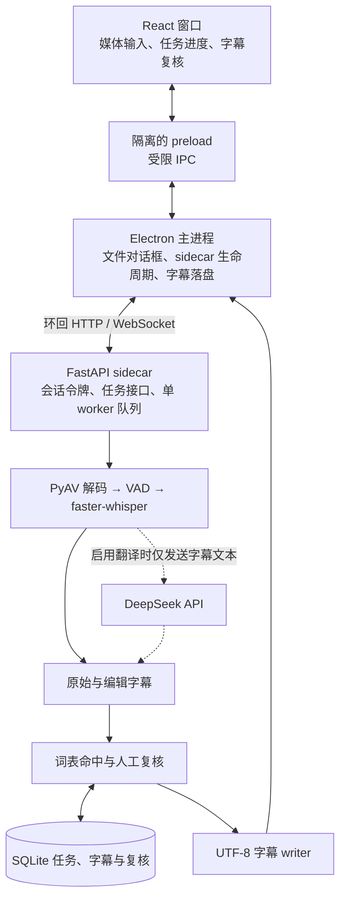

# Whisper工作台架构

Electron 在启动时生成会话令牌，并通过私有管道取得 sidecar 的就绪信息。sidecar 仅在 `127.0.0.1` 监听，主进程负责 HTTP 与 WebSocket 鉴权。渲染器通过 preload 操作任务和本地文件。

发布包包含 `app.asar` 和 PyInstaller 的 `resources/sidecar/`。Windows 安装版在安装目录创建 `model/`，应用按安装位置 `<安装目录>/model` 扫描本地 CTranslate2 模型和 VAD 文件，用户无需手写 `manifest.json`；设置页的模型列表和任务加载使用同一份扫描结果，缺件、权限与 VAD 回退状态分别展示。词表、数据库、录音和 `.env` 位于用户数据目录。临时录音由 sidecar 在任务结束时清理，Electron 在正常退出时处理剩余临时文件。

编辑保留原始输出。任务使用词表快照重新计算命中，复核与当前字幕一起保存。导出接口生成已保存字幕的 UTF-8 内容，主进程在用户选择的位置写入文件。
