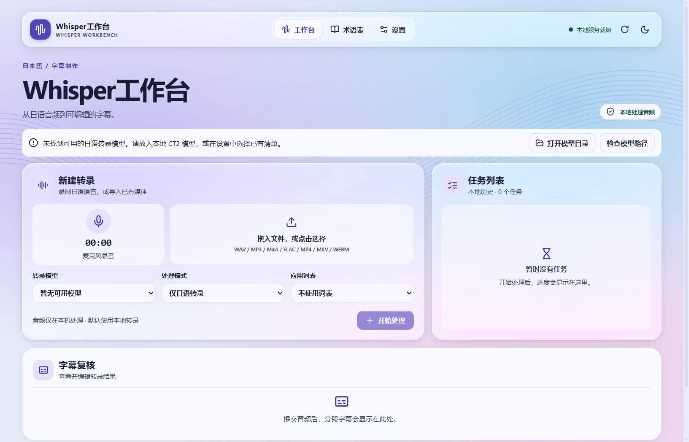
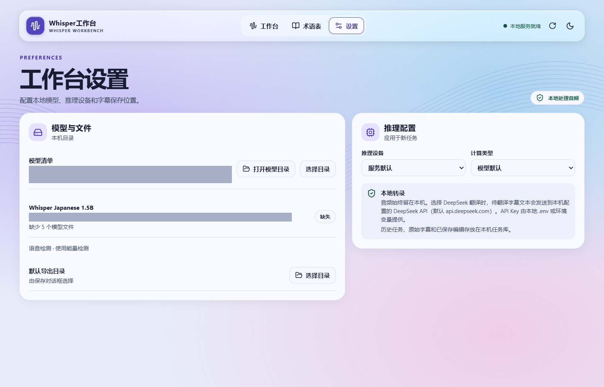
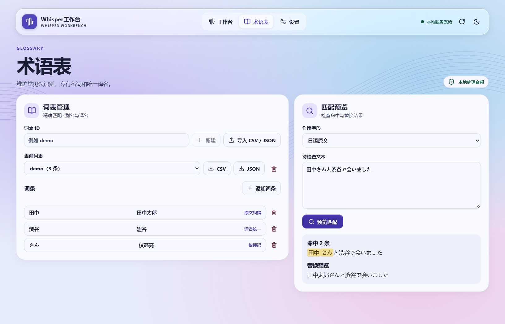

# Whisper工作台一分钟演示

在演示前放入本地 CT2 模型并准备一段约 10 秒的日语录音。以下字幕和词表演示文本均为合成示例。

| 时间 | 操作 | 画面 |
| --- | --- | --- |
| 00–10 秒 | 启动工作台，打开设置确认模型可用 | 显示本地服务与模型状态 |
| 10–25 秒 | 打开术语表，导入示例词表。用 `田中さんと渋谷で会いました` 预览 | 高亮 `田中` 和只标记的 `さん` |
| 25–40 秒 | 回到工作台拖入录音，选择词表后点「开始处理」 | 任务栏显示解码、语音检测和转录进度 |
| 40–52 秒 | 在字幕复核中对照原始输出，接受一条建议并保存手改 | 原始字幕保留，当前字幕更新 |
| 52–60 秒 | 选择 SRT 和覆盖策略，通过保存对话框导出 | 打开 UTF-8 字幕文件核对时间轴和内容 |

## Windows 打包版截图

设置页截图遮盖了本机验收目录的绝对路径。







## 合成字幕示例

模型输出

```srt
1
00:00:01,200 --> 00:00:04,350
田中さんと渋谷で会いました。
我和田中先生在渋谷见了面。
```

接受日语原文纠错和中文译名统一后导出

```srt
1
00:00:01,200 --> 00:00:04,350
田中太郎さんと渋谷で会いました。
我和田中先生在涩谷见了面。
```
